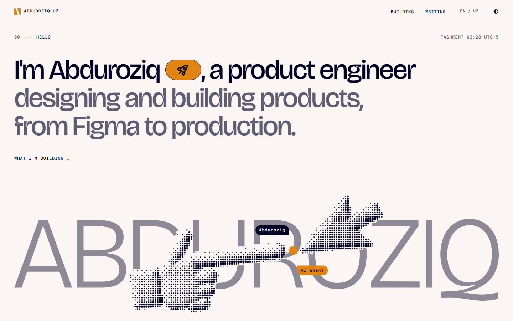
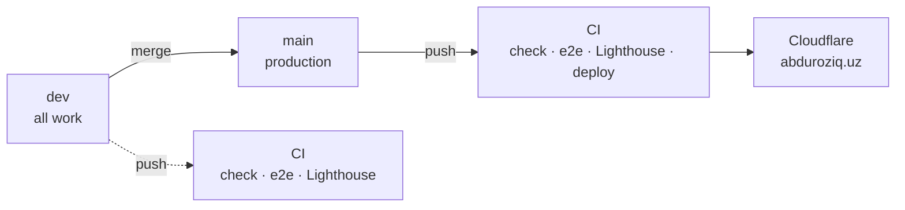

<div align="center">

<a href="https://abduroziq.uz">
  <picture>
    <source media="(prefers-color-scheme: dark)" srcset=".github/assets/home-dark.png">
    
  </picture>
</a>

# abduroziq.uz

**Personal website and blog of Abduroziq Jabborov, a product engineer in Tashkent.**<br>
Static, bilingual (English and Uzbek), type-first. Ink on paper, hairlines, one orange accent.

[**abduroziq.uz**](https://abduroziq.uz) · [Design](docs/DESIGN.md) · [Architecture](docs/ARCHITECTURE.md) · [Stack notes](docs/STACK-NOTES.md) · [Deploy](docs/DEPLOY.md) · [Security](SECURITY.md)

[](https://github.com/blogchik/abduroziq.uz/actions/workflows/ci.yml)
[](https://astro.build)
[](https://tailwindcss.com)
[](.nvmrc)
[](LICENSE)

</div>

---

## What is in it

|                         |                                                                                                                                    |
| ----------------------- | ---------------------------------------------------------------------------------------------------------------------------------- |
| **Statement & Meeting** | One large sentence, the name running edge to edge, and a hand cursor and an arrow cursor about to touch: the person and the agent. |
| **The desk**            | A few physical objects next to the About text that can be picked up and thrown.                                                    |
| **Projects**            | One folder per project, a page in both languages, case studies with images and video.                                              |
| **Writing**             | MDX posts and short notes, linked across languages, with drafts kept out of production.                                            |
| **Two languages**       | English at `/`, Uzbek at `/uz/`. One page file renders both.                                                                       |
| **Motion with weight**  | GSAP and Lenis behind data attributes. Every word is readable without JavaScript and under reduced motion.                         |
| **Light and dark**      | Follows the system; a toggle keeps an explicit choice.                                                                             |

## Stack

| Layer     | Tools                                                                    |
| --------- | ------------------------------------------------------------------------ |
| Framework | [Astro 7](https://astro.build), static output, MDX, content collections  |
| Styling   | [Tailwind CSS 4](https://tailwindcss.com) on top of design tokens        |
| Motion    | [GSAP](https://gsap.com) and [Lenis](https://lenis.darkroom.engineering) |
| Workspace | pnpm 10 and Turborepo, TypeScript, ESLint, Prettier                      |
| Testing   | unit tests, Playwright (desktop and phone), Lighthouse CI                |
| Hosting   | GitHub Actions builds, Cloudflare Workers serves the static assets       |

Pinned versions are newer than most references: [docs/STACK-NOTES.md](docs/STACK-NOTES.md) lists
the APIs verified for them.

## Repository

```text
abduroziq.uz
├── apps/
│   └── web/              @abduroziq/web       the Astro site: pages, layouts, components, motion
├── packages/
│   ├── content/          @abduroziq/content   profile, UI strings, posts, projects, images
│   └── config/           @abduroziq/config    shared TypeScript, ESLint and Prettier config
├── e2e/                  Playwright smoke suite
└── docs/                 DESIGN, ARCHITECTURE, STACK-NOTES, SEO, DEPLOY
```

## Quick start

Requires Node 24 (see `.nvmrc`) and pnpm 10 (`corepack enable` picks the right version).

```bash
corepack enable
pnpm install
pnpm dev          # http://localhost:4321, drafts visible
```

<details>
<summary><b>All commands</b></summary>

<br>

| Command            | What it does                                                                          |
| ------------------ | ------------------------------------------------------------------------------------- |
| `pnpm install`     | install the workspace                                                                 |
| `pnpm dev`         | dev server at http://localhost:4321, drafts visible                                   |
| `pnpm build`       | production build into `apps/web/dist`                                                 |
| `pnpm preview`     | serve the production build                                                            |
| `pnpm lint`        | ESLint                                                                                |
| `pnpm typecheck`   | `astro check` and `tsc`                                                               |
| `pnpm format`      | Prettier (`pnpm format:check` only checks)                                            |
| `pnpm test`        | unit tests                                                                            |
| `pnpm check:media` | fail on images and videos that carry metadata (GPS, device, editor data, paths)       |
| `pnpm check`       | format check, media check, lint, typecheck, tests and build; must pass before merging |
| `pnpm test:e2e`    | browser smoke suite on the built site (run `pnpm build` first)                        |

`pnpm test:e2e` serves `apps/web/dist` and drives Chromium (desktop and phone) through every page,
the motion modes and the page transition. It builds nothing and needs a browser once:
`pnpm exec playwright install chromium`. It is not part of `pnpm check`; CI runs it after the build.

</details>

## Writing and projects

All content lives in [`packages/content`](packages/content). Pages read it through typed
contracts, and the build fails with a message naming the file when something is off.

<table>
<tr>
<td width="33%" valign="top">

**Post**

`posts/<en|uz>/<slug>.mdx`

`title`, `description`, `date`, optional `tags`, `cover`, `updated` and `translationKey` (the
same value in both languages links a post and its translation).

[ARCHITECTURE 5.1](docs/ARCHITECTURE.md#51-posts-packagescontentpostslocaleslugmdx)

</td>
<td width="33%" valign="top">

**Note**

`posts/<en|uz>/<slug>.mdx` with `kind: note`

A short post: `title`, `date` and at most 300 words of plain text. No cover, heading, image
or component.

[posts/README](packages/content/posts/README.md)

</td>
<td width="33%" valign="top">

**Project**

`projects/<slug>/project.yaml`

Every fact in both languages, optional `en.mdx` / `uz.mdx` for the page text and `media/` for
images and video.

[projects/README](packages/content/projects/README.md)

</td>
</tr>
</table>

`draft: true` keeps a post out of production while it is written; drafts still show up in
`pnpm dev`.

## From `dev` to production



A commit that fails any check is never published, and what is published is the build that
passed them. Lighthouse CI fails a build below 100 for
accessibility and below 95 for best practices. Setup and secrets: [docs/DEPLOY.md](docs/DEPLOY.md).

## Licence

This repository has two licences, depending on the directory:

- **Code** (everything outside `packages/content`): [MIT licence](LICENSE).
- **Content** (everything in `packages/content`: posts, site copy, photos and other images):
  [(c) Jabborov Abduroziq, all rights reserved](packages/content/LICENSE). It is not covered by
  the MIT licence and is published here so the site can be built, not to be reused.

<div align="center">
<br>
<sub>Built in Tashkent · <a href="https://abduroziq.uz">abduroziq.uz</a></sub>
</div>
